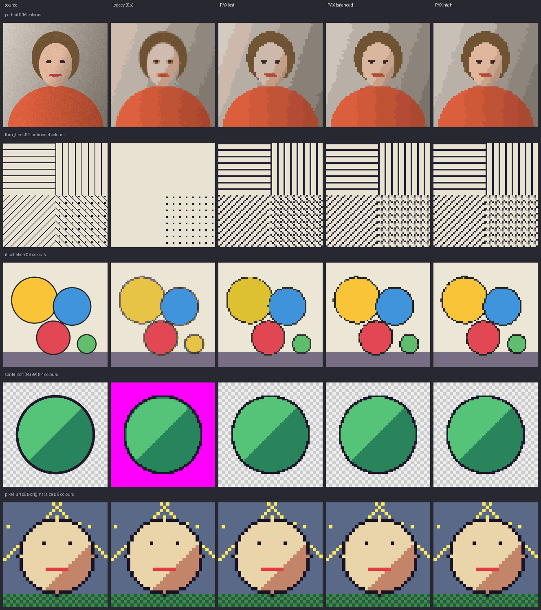

# Smart Pixel Art Downscaler

Structure-preserving, perceptually optimised downscaling for pixel art, written in Rust with
WebAssembly bindings. Give it an image of any size and aspect ratio, a target size and a colour
budget; it returns indexed pixel art that keeps the source's edges, thin features, colours and
contrast instead of averaging them away.



*Left to right: source, the 0.x pipeline with its defaults, and 1.0 in `fast`, `balanced` and
`high` quality. Every row is produced by `cargo run --release --example regression`.*

**Version 1.0.0** replaces the 0.x pipeline with **PAX — Perceptual Adaptive eXtraction**
(adaptive K-Centroid sampling, a palette built from what the sampling selected, automatic
colour compensation and artifact validation). The 0.x pipeline is still included
(`Engine::Legacy`) and every 0.x API keeps working. See [What changed](#migrating-from-0x)
and [CHANGELOG.md](CHANGELOG.md); the design is documented in
[docs/ARCHITECTURE.md](docs/ARCHITECTURE.md).

## Contents

- [Install and build](#install-and-build) · [Quick start](#quick-start) · [How it works](#how-it-works)
- [Quality modes](#quality-modes) · [Configuration reference](#configuration-reference) · [Diagnostics](#diagnostics)
- [API reference](#api-reference) · [Recipes](#recipes) · [Performance](#performance)
- [Determinism](#determinism) · [Testing](#testing) · [Migrating from 0.x](#migrating-from-0x)
- [Known limitations](#known-limitations) · [CLI](#cli) · [License and credits](#license-and-credits)

## Install and build

**Rust**

```toml
[dependencies]
smart-downscaler = "1.0"                                                        # library + CLI, multi-threaded
smart-downscaler = { version = "1.0", default-features = false }                # no image I/O, no rayon, no dependencies beyond ordered-float
smart-downscaler = { version = "1.0", default-features = false, features = ["parallel"] }
```

| Feature | Default | Adds |
|---|---|---|
| `native` | yes | `image` (CLI, `to_image`, `downscale(&RgbImage, …)`) and `parallel` |
| `parallel` | via `native` | rayon-based footprint extraction. **Output is identical with or without it.** |
| `wasm` | no | wasm-bindgen exports (build with `--no-default-features --features wasm`) |

**WebAssembly**

```bash
rustup target add wasm32-unknown-unknown
cargo install wasm-bindgen-cli --version 0.2.130 --locked   # the version Cargo.lock pins
./build-wasm.sh              # pkg/web, pkg/bundler, pkg/nodejs + pkg/package.json
node scripts/check-wasm.mjs  # proves the build reproduces the native library bit for bit
```

Each `pkg/<target>` folder contains the generated bindings (`smart_downscaler.js`) and the
high-level wrapper (`smart-downscaler.js`, `.mjs` for Node). `examples/demo.html` is a small
page that uses the wrapper; serve the repository over HTTP to try it.

## Quick start

**Rust**

```rust
use smart_downscaler::prelude::*;

let img = image::open("input.png")?.to_rgba8();
let config = DownscaleConfig { palette_size: 16, ..Default::default() };   // PAX, Balanced
let result = smart_downscale_rgba(img.as_raw(), img.width() as usize, img.height() as usize, 64, 64, &config);

result.to_rgba_image().save("output.png")?;      // alpha preserved when the source has any
println!("{} colours used, edge retention {:.2}",
    result.colors_used(), result.diagnostics.as_ref().unwrap().edge_retention);
```

Opaque `&[Rgb]` input goes through `smart_downscale`; `try_smart_downscale*` return a
`DownscaleError` instead of panicking on mismatched sizes.

**JavaScript (wrapper)**

```js
import * as sd from './pkg/web/smart-downscaler.js';
await sd.init();

const out = sd.downscale(canvasOrImageOrImageData, 64, 64, { paletteSize: 16, quality: 'high' });
ctx.putImageData(out.imageData, 0, 0);
console.log(out.colorsUsed, out.diagnostics.edge_retention, out.digest);

// Many sizes or palettes from one source: prepare once.
const prepared = sd.prepare(image, { quality: 'balanced' });
const icon = prepared.downscale(32, 32, { paletteSize: 8 });
const pico = prepared.downscaleWithPalette(96, 96, sd.getPresetPalette('pico8'));
prepared.free();
```

**JavaScript (raw bindings, as in 0.x)**

```js
import init, { WasmDownscaleConfig, downscale_rgba } from './pkg/web/smart_downscaler.js';
await init();
const config = WasmDownscaleConfig.high();
config.palette_size = 16;
const result = downscale_rgba(imageData.data, imageData.width, imageData.height, 64, 64, config);
const output = new ImageData(result.data, result.width, result.height);
```

**CLI**

```bash
smart-downscaler photo.jpg sprite.png -w 64 -c 16
smart-downscaler art.png small.png -s 0.25 -q high --diagnostics --preview 8
```

## How it works

Classic pipelines average each tile, extract a palette from the averages and snap pixels to
it. Averaging blurs edges, deletes thin features and washes colours out before the palette is
even built; later sharpening or saturation filters then amplify the damage. PAX never averages
across structures in the first place, and it measures what it loses.

| Stage | What happens |
|---|---|
| **01 Source analysis** | Resolution cap, alpha classification, colour statistics. The image is converted once to the working space (Oklab with a perceptual lightness toe) with deterministic arithmetic. |
| **02 Structural analysis** | Per pixel: edge strength and a *transition score* that tells anti-aliasing and blur pixels (a blend of their neighbours) from real colours, plus the image's noise floor. |
| **03 Adaptive K-Centroid extraction** | Every output pixel owns an exact fractional source footprint. Its samples are clustered into 1–6 colour candidates — as many as the footprint really contains — with deterministic seeding and a perceptual distance; blend pixels are discounted, so candidates are pure colours. The footprint then picks the candidate with the highest *importance* (area × saliency × chroma × feature evidence), not simply the largest. Thin features are kept one pixel wide, never doubled; one-pixel gaps in contours are closed. |
| **04 Global palette construction** | The palette is built from the selected colours, weighted by perceptual importance. Colours are grouped into *families* (ramps of one material); a tint is not allowed to be represented by a grey just because greys dominate the picture. Under-served colours get their own entry when that gains more than it costs. |
| **05 Automatic colour compensation (APC)** | Chroma, contrast and lightness-distribution losses are measured per palette entry and restored by moving palette entries — hue preserved, gamut mapped, highlights and shadows protected, bounded per entry. A joint objective decides how much; nothing is done without evidence. |
| **06 Pixel reconstruction** | Every output pixel is assigned a palette entry: nearest match, then an edge-aware coherence pass that never smooths across boundaries and never moves a pixel to a visibly different colour. |
| **07 Artifact validation (AAS)** | Isolated pixels that have no source evidence are repaired, intentional ones are kept; structure and colour error are measured and reported. |

The complete description, with every formula and constant, is in
[docs/ARCHITECTURE.md](docs/ARCHITECTURE.md).

## Quality modes

| | `fast` | `balanced` (default) | `high` | `maximum` |
|---|---|---|---|---|
| Use for | previews, live sliders | general use | exports | offline, hardest inputs |
| Candidates per footprint (max) | 2 | 3 | 4 | 6 |
| Transition (anti-aliasing) analysis | off | on | on | on |
| Footprint samples (max) | 256 | 1 024 | 4 096 | all |
| Clustering passes | 1 | 1 | 2 | 2 |
| Neighbourhood saliency | basic | full | full | full |
| Contour bridging | off | on | on | on |
| Palette optimisation iterations | 1 | 2 | 4 | 8 |
| Palette split–merge | off | off | on | on |
| Assignment refinement passes | 1 | 2 | 3 | until stable (≤ 12) |
| Isolated-pixel validation | single pixels | single pixels | pairs | pairs |
| Working resolution cap | 1.0 MP | 1.6 MP | 2.0 MP | 4.0 MP |
| Colour preprocess threshold | 8 192 | 16 384 | 32 768 | 32 768 |

`DownscaleConfig::fast()/balanced()/high()/maximum()` (Rust), `WasmDownscaleConfig.fast()` …
(bindings), `{ quality: 'high' }` (wrapper), `-q high` (CLI).

## Configuration reference

`DownscaleConfig` (Rust) ↔ `WasmDownscaleConfig` properties (bindings) ↔ wrapper options.
Every field has a default; `..Default::default()` keeps 0.x code compiling.

### General

| Rust | Bindings / wrapper | Default | Meaning |
|---|---|---|---|
| `engine` | `engine` / `engine` | `Pax` | `Pax` or `Legacy` (the 0.x pipeline) |
| `quality_mode` | `quality_mode` / `quality` | `Balanced` | See [Quality modes](#quality-modes) |
| `palette_size` | `palette_size` / `paletteSize` | 16 | Colours, 1–256 |
| `palette_strategy` | `palette_strategy` / `paletteStrategy` | `OklabMedianCut` | How the palette is first cut: `oklab`, `saturation`, `medoid` (exact source colours), `kmeans`, `legacy`, `bitmask` |
| `kmeans_iterations` | `kmeans_iterations` / `kmeansIterations` | 5 | Palette refinement iterations |
| `max_resolution_mp` | `max_resolution_mp` / `maxResolutionMp` | 1.6 | Sources above this many megapixels are area-reduced first (0 = never) |
| `max_color_preprocess` | `max_color_preprocess` / `maxColorPreprocess` | 16 384 | Sources with more distinct colours are reduced to ≤ 32 768 first (0 = never) |
| `edge_weight` | `edge_weight` / `edgeWeight` | 0.5 | Structural analysis: 0 = lightness edges only, 1 = colour edges only |
| `segmentation` | `segmentation_method` (+ `slic_*`, `hierarchy_*`) / `segmentation` | `None` | Optional source segmentation; when present, palette smoothing does not cross segment borders |
| `color_rarity` | `color_rarity` / `colorRarity` | 0 | 0–1: flatten the area weighting so rare colours pull harder |
| `detail_boost` | `detail_boost` / `detailBoost` | 0 | 0–1: extra palette weight for colours on edges |
| `reserve_colors` | `reserve_colors` / `reserveColors` | 0 | Minimum number of slots given to distinct, under-served colours (reservation is automatic; this forces a floor) |
| `skin_protection` | `skin_protection` / `skinProtection` | 0 | 0–1: treat skin tones as a class of their own (extra weight, no mixing with non-skin entries) |

### Adaptive K-Centroid — `centroid: CentroidConfig`

| Rust | Bindings / wrapper | Default | Meaning |
|---|---|---|---|
| `max_centroids` | `max_centroids` / `maxCentroids` | 0 | Upper bound on candidates per footprint, 1–6; 0 = from the quality mode |
| `min_centroids` | `min_centroids` / `minCentroids` | 1 | Used when `adaptive` is off |
| `adaptive` | `adaptive_centroids` / `adaptiveCentroids` | true | Choose the count from the footprint's content (uniform → 1, boundary → 2, …) |
| `deterministic` | `deterministic` | true | false = reference-style pseudo-random seeding (still reproducible: fixed seed) |
| `edge_weight` | `centroid_edge_weight` / `centroidEdgeWeight` | 0.85 | How strongly blend (anti-aliasing) pixels are discounted when clustering |
| `saliency_weight` | `saliency_weight` / `saliencyWeight` | 1.0 | Exponent of local saliency in the importance |
| `chroma_weight` | `chroma_weight` / `chromaWeight` | 0.5 | Exponent of chroma in the importance |
| `metric` | — | see below | `PerceptualMetric { w_l: 1, w_c: 6, w_h: 6, k_c: 12, k_h: 5, w_e: 0.008 }` |

### Colour compensation — `compensation: CompensationConfig`

| Rust | Bindings / wrapper | Default | Meaning |
|---|---|---|---|
| `automatic` | `auto_compensation` / `autoCompensation` | true | Master switch for the `Automatic` modes |
| `chroma` | `chroma_compensation` / `chromaCompensation` | `Automatic` | `Off`, `Automatic`, `Manual(gain)`. Bindings: negative = auto, 0 = off, > 0 = gain. Wrapper: `'auto'`, `'off'`, number |
| `contrast` | `contrast_compensation` / `contrastCompensation` | `Automatic` | as above |
| `luminosity` | `luminosity_compensation` / `luminosityCompensation` | `Automatic` | as above (lightness distribution: shadows, mid-tones, highlights) |
| `strength` | `compensation_strength` / `compensationStrength` | 1.0 | Scales all three, 0–2 |
| `preserve_hue` | `preserve_hue` / `preserveHue` | true | Chroma changes move along the entry's own hue |
| `preserve_highlights`, `preserve_shadows` | same / `preserveHighlights`, `preserveShadows` | true | Soft limits at the source's own extremes |
| `local_adaptation` | `local_adaptation` / `localAdaptation` | true | Use edge-contrast evidence and the reduction ratio when deciding the amount |
| `gamut_mapping` | `gamut_mapping` / `gamutMapping` | `Perceptual` | `Perceptual` keeps hue and lightness and reduces chroma; `Clip` clamps channels |
| `color_preservation` | `color_preservation` / `colorPreservation` | `High` | Maximum move of a palette entry: `High` 0.05, `Medium` 0.08, `Low` 0.12 (working-space units) |

`CompensationConfig::off()` disables everything. Compensation is not applied to caller-supplied
palettes or in exact-colour mode.

### Structure — `structure: StructureConfig`

| Rust | Bindings / wrapper | Default | Meaning |
|---|---|---|---|
| `edge_preservation` | `edge_preservation` / `edgePreservation` | 0.8 | 1 = always the pure winning colour; lower values blend footprints toward their true mixture |
| `thin_feature_preservation` | `thin_feature_preservation` / `thinFeaturePreservation` | 0.6 | How much a coherent small cluster (line, dot, outline) can outweigh a larger one |
| `contour_preservation` | `contour_preservation` / `contourPreservation` | 0.7 | Willingness to close one-pixel gaps in thin contours |
| `spatial_coherence` | `spatial_coherence` / `spatialCoherence` | 0.5 | Edge-aware smoothing of palette assignments (0 = nearest colour only) |

### Artifact avoidance — `artifacts: ArtifactConfig`

| Rust | Bindings / wrapper | Default | Meaning |
|---|---|---|---|
| `validate` | `validate` | true | Isolated-pixel validation and the structure measurements |
| `prevent_color_bleeding` | `prevent_color_bleeding` / `preventColorBleeding` | true | Smoothing may only move a pixel to a near-equivalent colour |
| `prevent_halos` | `prevent_halos` / `preventHalos` | true | Back off contrast compensation that would overshoot across edges |
| `preserve_alpha` | `preserve_alpha` / `preserveAlpha` | true | Honour source transparency (false = 0.x behaviour) |
| `alpha_mode` | `alpha_mode` / `alphaMode` | `Auto` | `Auto`: binary output for hard-edged sources, partial otherwise; `Binary`; `Preserve` |
| `alpha_threshold` | `alpha_threshold` / `alphaThreshold` | 0.5 | Coverage needed for an output pixel to be visible |

### Legacy engine only

`neighbor_weight`, `region_weight`, `two_pass_refinement`, `refinement_iterations`, `k_centroid`
(1 average, 2 dominant, 3 foremost), `k_centroid_iterations`, `chroma_recovery`. PAX ignores
them: its footprint clustering, coherence pass and compensation replace them.

## Diagnostics

`DownscaleResult::diagnostics` (`result.diagnostics` in JS; `--diagnostics` on the CLI) reports
what the pipeline measured. Colour quantities are in working-space units, comparable to ΔE in
Oklab: about 0.02 is one just-noticeable difference.

| Field | Meaning |
|---|---|
| `source_colorfulness`, `output_colorfulness` | Mean chroma of source and output |
| `source_contrast`, `output_contrast` | Standard deviation of lightness |
| `source_lightness`, `output_lightness` | Mean lightness |
| `chroma_loss`, `contrast_loss`, `luminosity_drift` | What the uncompensated palette had lost |
| `chroma_recovered`, `contrast_recovered`, `luminosity_recovered` | Share of that loss restored, 0–1 |
| `structural_error` | Edge disagreement between source and output at output resolution, 0 (best) – 1 |
| `edge_retention` | Share of the source's edge evidence present in the output |
| `color_error` | RMS distance between the colour each pixel was meant to show and the colour it got |
| `hue_shift_deg` | Mean hue rotation caused by compensation |
| `objective_before`, `objective_after`, `optimization_iterations` | The joint objective around compensation |
| `palette_used`, `mean_candidates`, `noise_floor` | Palette entries in use, candidates per footprint, estimated source noise |
| `artifacts` | `features_kept`, `features_thinned`, `contour_gaps_bridged`, `coherence_flips`, `isolated_examined/removed/kept`, `bleeding_prevented`, `halo_edges`, `drift_limited_entries`, `gamut_limited_entries` |

## API reference

### Rust

| Function | Purpose |
|---|---|
| `smart_downscale(&[Rgb], w, h, tw, th, &cfg)` | Opaque input |
| `smart_downscale_rgba(&[u8], w, h, tw, th, &cfg)` | RGBA input (straight alpha) |
| `smart_downscale_with_palette`, `smart_downscale_rgba_with_palette` | Fixed palette, used verbatim |
| `prepare_image`, `prepare_image_rgba` → `PreparedImage` | Size-independent work, done once |
| `smart_downscale_prepared`, `smart_downscale_prepared_with_palette` | Any number of sizes / palettes from a prepared image |
| `try_smart_downscale`, `try_smart_downscale_rgba` | `Result<_, DownscaleError>` instead of panics |
| `downscale(&RgbImage, …)`, `downscale_rgba(&RgbaImage, …)` | `image` crate convenience (`native`) |
| `palette::extract_palette*` | Palette extraction without downscaling (0.x API) |

`DownscaleResult { width, height, pixels, palette, palette_indices, segmentation, alpha,
diagnostics }` with `to_image()`, `to_rgba_image()`, `to_rgba_bytes()`, `to_rgb_bytes()`,
`colors_used()`, `digest()`. `smart_downscaler::synth` holds the procedural test charts.

### WebAssembly bindings

Unchanged from 0.x: `downscale`, `downscale_rgba`, `downscale_simple`, `downscale_with_palette`,
`prepare`, `prepare_rgba`, `downscale_prepared`, `downscale_prepared_with_palette`,
`extract_palette_from_image`, `quantize_to_palette`, `analyze_colors`, `get_palette_strategies`,
`rgb_to_oklab`, `oklab_to_rgb`, `get_chroma`, `get_lightness`, `color_distance`, `version`,
`log`, and the classes `WasmDownscaleConfig`, `WasmDownscaleResult`, `WasmPreparedImage`,
`ColorEntry`, `ColorAnalysisResult`.

New in 1.0: `get_quality_modes()`, `get_engines()`, `test_chart(name, w, h)`;
`WasmDownscaleConfig.balanced()/high()/maximum()/legacy()`, `.clone()` and the properties in
the tables above; `WasmDownscaleResult.alpha`, `.has_alpha`, `.colors_used`, `.diagnostics`,
`.digest`; `WasmPreparedImage.source_width`, `.source_height`, `.resolution_capped`,
`.has_alpha`. Invalid input now throws an `Error` with a message instead of trapping.

### JavaScript wrapper (`smart-downscaler.js`)

`init`, `isReady`, `downscale`, `downscaleSimple`, `downscalePreset`, `downscaleWithPalette`,
`prepare`, `extractPalette`, `quantize`, `analyzeColors`, `createConfig`, `version`,
`getPaletteStrategies`, `getQualityModes`, `getEngines`, `getPresets`, `getPresetPalette`
(`gameboy`, `nes`, `cga`, `pico8`, `commodore64`, `apple2`), `getPresetPaletteNames`,
`rgbToOklab`, `oklabToRgb`, `getChroma`, `getLightness`, `colorDistance`, `testChart`.
Sources may be `ImageData`, any `{data, width, height}`, canvases, `OffscreenCanvas`, images,
`ImageBitmap` or video elements. Typings: `smart-downscaler.d.ts`.

### Presets

| Preset | What it is |
|---|---|
| `fast`, `balanced`, `high`, `maximum` | The quality modes |
| `quality` | `high` with 32 colours and 10 palette iterations |
| `vibrant` | 24 colours, saturation-weighted cut, chroma gain 1.35, `Medium` colour preservation |
| `exact_colors` | Medoid palette: every output colour exists in the source; no compensation, no colour preprocessing |
| `legacy` | The 0.x pipeline with its 0.x defaults (hierarchical segmentation, averaged tiles) |

## Recipes

**Faces and portraits.** The defaults already keep skin apart from neutral backgrounds (colour
families). For the last bit: `high` quality and, if the palette is very small, `skin_protection: 0.5`.

**A sprite that was exported too large.** Downscale back to its logical size: flat-colour
footprints are recovered exactly (see `upscaled_pixel_art_is_recovered_exactly` in the tests).
Use `exact_colors()` if no colour may change at all.

**A fixed palette (PICO-8, NES, your own).** `smart_downscale_with_palette` /
`sd.downscaleWithPalette(img, w, h, sd.getPresetPalette('pico8'))` /
`--use-palette pico8.png`. Structure extraction and assignment still apply; the palette is not touched.

**Transparency.** Pass RGBA. Fully transparent pixels never influence colour (whatever their
RGB), hard-edged sprites get hard-edged output, soft sources keep partial alpha.
`alpha_mode: Binary` forces a hard edge; `preserve_alpha: false` ignores alpha.

**Punchier output.** `vibrant()`, or `compensation.chroma = Manual(1.3)`. Prefer this to
filtering the result afterwards: compensation works per palette entry, respects gamut and hue,
and cannot create halos.

**Previews at many sizes.** `prepare_image` once (more than half the cost of a call), then
`smart_downscale_prepared` per size or palette.

## Performance

Best of several runs, complete call (prepare + downscale) to 64 px wide and 16 colours, on a
2-core x86-64 VM (Rust 1.97, `--release`; WebAssembly in Node 22). Reproduce with
`cargo run --release --example bench_compare` and `cargo bench`.

| Source | Configuration | Native ms | WASM ms |
|---|---|---:|---:|
| 512 × 512 | 0.x, no segmentation (`fast()` of 0.x) | 8.2 | 12.3 |
| | 0.x, `hierarchy_fast` (0.x WASM default) | 57.8 | 55.4 |
| | 0.x, `hierarchy` (0.x Rust default) | 2 336 | — |
| | **PAX fast** | 17.1 | 33.6 |
| | **PAX balanced (default)** | 21.7 | 38.6 |
| | **PAX high** | 24.2 | 45.1 |
| | **PAX maximum** | 31.8 | 56.6 |
| 1024 × 1024 | 0.x, no segmentation | 32.4 | 44.8 |
| | 0.x, `hierarchy_fast` | 252 | 252 |
| | **PAX fast / balanced / high / maximum** | 55 / 72 / 64 / 74 | 98 / 131 / 138 / 137 |
| 1280 × 720 | 0.x, no segmentation | 25.9 | 38.7 |
| | 0.x, `hierarchy_fast` | 204 | 204 |
| | **PAX fast / balanced / high / maximum** | 41 / 46 / 53 / 51 | 57 / 75 / 78 / 83 |

Reading the table:

- Against the **defaults of 0.x** (both use a segmentation), the 1.0 default is 2.7–4.4× faster
  natively and 1.4–2.7× faster in WebAssembly — and about 100× faster than the 0.x Rust
  default.
- Against the **cheapest 0.x configuration** (no segmentation, averaged tiles), PAX balanced is
  about 1.8–2.7× slower natively and about 2–3× slower in WebAssembly. That configuration does
  none of the structural work; it remains available as `Engine::Legacy` with
  `SegmentationMethod::None`.
- 55–75 % of a PAX call is `prepare` (conversion and structural analysis, ≈ 35–45 ns per source
  pixel). A second size or palette from a `PreparedImage` costs roughly 5–35 ms at these sizes.
- Above the resolution cap the source is reduced first, so cost stops growing with source size.

Implementation notes: contiguous buffers; 8-byte working pixels; conversion memoised by exact
colour; per-thread scratch reused across footprints (no per-footprint heap allocation, no hash
maps in clustering loops); fixed-size candidate arrays; precomputed footprint spans; footprint
rows extracted in parallel and concatenated in row order.

## Determinism

Output is a pure function of the input and the configuration. Decision paths use no platform
math (`cbrt`, `pow`, `atan2` are computed with fixed arithmetic), no random numbers and no
hash-order-dependent iteration, and parallel work is reduced in a fixed order. As a result:

- repeated runs, single- and multi-threaded builds, and **native and WebAssembly builds
  produce bit-identical results** (`DownscaleResult::digest()` / `result.digest`);
- `cargo run --release --example digest` and `node scripts/check-wasm.mjs` print and compare
  the digests of every preset on every built-in chart (combined digest of 1.0.0:
  `9e38d13c08509990`).

The legacy engine is deterministic as well in 1.0 (0.6 native builds were not: palette
extraction depended on hash-map iteration order).

## Testing

```bash
cargo test --release                       # 168 unit tests, 24 release gates, doc tests
cargo run --release --example regression   # measurements + contact sheets in regression-out/
cargo run --release --example digest       # determinism table
cargo bench                                # criterion benchmarks
```

`tests/release_gates.rs` encodes the acceptance criteria on procedural charts with known
content: determinism; exact recovery of enlarged pixel art; compensation never increasing
chroma / contrast / lightness drift; crisper edges and more accurate structure than the legacy
engine; thin-line retention without invented features; checkerboards and gradients; alpha
correctness (no colour contamination, no fringes, hard edges stay hard); all aspect ratios,
extreme and non-integer reductions, tiny palettes and degenerate inputs; fixed and exact-colour
palettes; 0.x configuration compatibility.

## Migrating from 0.x

Nothing has to change to compile: all 0.x functions, fields, bindings and CLI flags are still
there. What behaves differently by default:

| | 0.x | 1.0 | To get the old behaviour |
|---|---|---|---|
| Pipeline | averaged tiles + neighbour refinement | PAX | `engine: Engine::Legacy`, `DownscaleConfig::legacy()`, `WasmDownscaleConfig.legacy()`, `--engine legacy` |
| Default segmentation | `Hierarchy` (Rust), `hierarchy_fast` (WASM) | `None` | set `segmentation` explicitly |
| Alpha | ignored | honoured | `artifacts.preserve_alpha = false` / `--alpha ignore` |
| `k_centroid`, `neighbor_weight`, `region_weight`, `two_pass_refinement`, `refinement_iterations`, `chroma_recovery` | used | used by the legacy engine only | select the legacy engine |
| Unknown strategy / segmentation names in the bindings | silently replaced by a default | throw | — |
| CLI `-w` alone | height stayed a quarter of the source | aspect ratio kept | pass `-h` too |
| Colour rounding | truncating | rounding | — |
| `DownscaleResult` | 6 fields | + `alpha`, `diagnostics` | add `..` when destructuring |

Fixes that apply to both engines: deterministic palette extraction, RGBA handling in
`quantize_to_palette` / `extract_palette_from_image`, a compiling benchmark, wrapper functions
that the typings declared but the module did not export, and the wrapper's import path.

## Known limitations

- **"Artifact-free" is a design goal, not a guarantee.** The validation stage removes or
  prevents the artifact classes listed in the architecture document and reports what it did;
  a 16-colour image of a photograph still bands in smooth gradients.
- **Regular patterns near the sampling limit** (a 3-pixel checkerboard reduced 4×) cannot be
  represented; the result is a regular pattern rather than blotches, but its mean brightness
  can be off.
- **Small palettes on busy photographs** force choices. Families and reservation decide in
  favour of distinct colours over extra shades; raise `palette_size` if a ramp looks coarse.
- **Colour families use a fixed separation threshold.** Two materials whose chromaticities are
  closer than about one just-noticeable difference are treated as one family.
- **`prepare` is single-threaded**; only footprint extraction is parallel.
- **No dithering.** Output is flat indexed colour by design.
- The demo page was syntax-checked and its code paths were exercised in Node, not in a browser.

## CLI

```text
smart-downscaler [OPTIONS] <INPUT> <OUTPUT>

  -w, --width <PX>   -h, --height <PX>   -s, --scale <FACTOR>     size (default: a quarter of the source)
  -c, --colors <N>   (alias -p, --palette)                         palette size, default 16
      --palette-strategy <oklab|saturation|medoid|kmeans|legacy|bitmask>
      --use-palette <image | "hex,hex,…">     --save-palette <FILE>
      --reserve-colors <N>   --color-rarity <0..1>   --skin-protection <0..1>
  -q, --quality <fast|balanced|high|maximum>   --preset <NAME>   --engine <pax|legacy>   --max-mp <MP>
      --chroma|--contrast|--luminosity <auto|off|GAIN>   --strength <0..2>
      --color-preservation <low|medium|high>   --no-compensation
      --edge-preservation|--thin-features|--contours|--coherence <0..1>   --no-validation
      --alpha <auto|binary|preserve|ignore>   --alpha-threshold <0..1>
      --preview <N>   --diagnostics   --quiet   -V, --version   --help
  legacy engine: -n, --neighbor-weight  -r, --region-weight  --no-refinement
                 --segmentation <none|slic|hierarchy|hierarchy-fast>  --k-centroid  --k-centroid-iterations
```

Options are applied in order, so `--preset high -c 8 --chroma 1.2` refines a preset.

## License and credits

MIT — see [LICENSE](LICENSE).

- Oklab and its lightness estimate `Lr` by Björn Ottosson.
- The K-Centroid idea (per-tile clustering, pick a cluster) from Astropulse's K-Centroid
  scaler for Aseprite; 1.0 generalises it to fractional footprints, adaptive counts,
  perceptual distances and importance-based selection.
- SLIC superpixels (Achanta et al.) and VTracer-style hierarchical clustering for the optional
  segmentations.

Repository: <https://github.com/pixagram-blockchain/smart-downscaler>
